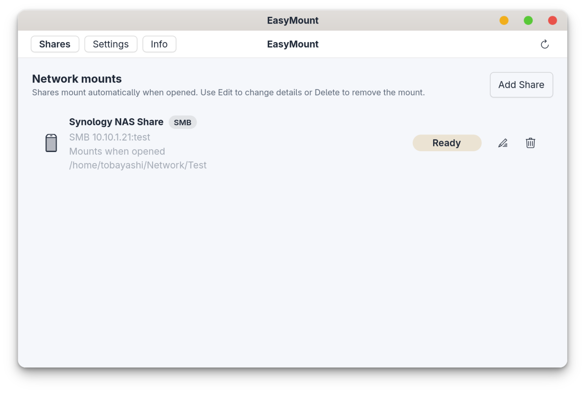

# EasyMount

EasyMount is a Linux desktop app for setting up persistent SMB and NFS network
mounts without editing `fstab` by hand. It provides a GTK 4 GUI, stores share
profiles in your user config, keeps SMB passwords in Secret Service and uses a
small Polkit-protected host helper to create systemd mount units.

This is an early release. The main mount flow works, but packaging and desktop
integration are still being refined.

## Screenshots



More views, plus an interactive light/dark comparison, are on the
[project page](https://tobayashi-san.github.io/EasyMount/).

## Features

- Add, edit and delete SMB and NFS mounts from a GUI
- Choose per share whether systemd mounts it on access or keeps it mounted
- Persist mounts across reboots through systemd `.mount` and `.automount` units
- Store SMB passwords through `secret-tool` instead of writing them to unit files
- Check host requirements from the Settings page
- Optional sidebar entries for GNOME Files, GTK file pickers and KDE Places
- AppImage and Flatpak builds for testing on different distributions

## Install

Download the latest files from the
[GitHub Releases page](https://github.com/tobayashi-san/EasyMount/releases).

AppImage:

```sh
chmod +x EasyMount-0.1.1-x86_64.AppImage
./EasyMount-0.1.1-x86_64.AppImage
```

Flatpak bundle:

```sh
flatpak install --user EasyMount-0.1.1-x86_64.flatpak
flatpak run org.easymount.EasyMount
```

On first run, open `Settings -> Host helper` and use `Install / Update Helper`.
The helper is required because sandboxed apps and normal user processes cannot
write systemd mount units directly.

## System Requirements

EasyMount targets systemd-based Linux distributions. Install distro packages
that provide:

- Python 3.10+
- GTK 4 and PyGObject
- Secret Service / libsecret `secret-tool`
- Polkit / `pkexec`
- systemd / `systemctl`
- `cifs-utils` for SMB shares
- NFS client tools, usually `nfs-utils` or `nfs-common`

The Settings page checks the host helper, systemd, SMB/NFS mount helpers and
secret storage availability.

## Development Install

For source-tree testing, install the helper and desktop integration files:

```sh
sudo ./scripts/install-helper.sh
python -m easymount.app
```

Uninstall the development install:

```sh
sudo ./scripts/uninstall-helper.sh
```

Delete configured shares in the GUI first if you want their generated systemd
mount units removed cleanly. The uninstall script intentionally keeps user
profiles and saved secrets.

## Documentation

- [Installation](docs/INSTALL.md)
- [Uninstall](docs/UNINSTALL.md)
- [Development](docs/DEVELOPMENT.md)
- [Packaging](docs/PACKAGING.md)
- [Architecture](docs/ARCHITECTURE.md)
- [Helper protocol](docs/helper-protocol.md)

## Security Model

EasyMount does not mount network shares directly from the GUI. The GUI asks a
small host helper to validate profiles and create or remove systemd units. That
helper is exposed through a single Polkit action. SMB passwords are passed only
when needed and are written to root-owned runtime credential files under
`/run/easymount`.

By default the shipped Polkit rule (`org.easymount.helper.rules`) grants this
action to **active, local** desktop sessions without an extra password prompt.
This is intentional: it lets the login agent restore saved SMB credentials,
start deferred authenticated automounts and restore "always mounted" shares
after login without forcing the user to authenticate on every boot. Remote or
inactive sessions fall back to the `auth_admin` defaults in the policy and must
authenticate.

If you prefer an authentication prompt for every privileged change, remove
`/usr/share/polkit-1/rules.d/org.easymount.helper.rules`; the `auth_admin`
defaults in the `.policy` file then apply (note: unattended post-login restore
will then require interactive authentication and may not complete).

The helper still enforces that a profile may only be created for the calling
user (`PKEXEC_UID`) and only below that user's `~/Network` directory, and it
rejects symlinked mount paths so privileged operations cannot escape that tree.

Flatpak may show broad-permission warnings because EasyMount needs home access
for mount paths, network access for share checks, Secret Service access for SMB
passwords and host access to install or call the helper.

## Project Status

EasyMount is version `0.1.1`. Treat it as a test release and keep backups of
important mount configuration while trying it. Bug reports and reproducible
mount errors are welcome in
[GitHub Issues](https://github.com/tobayashi-san/EasyMount/issues).
